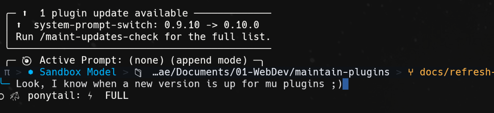
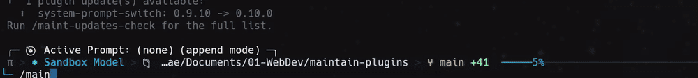
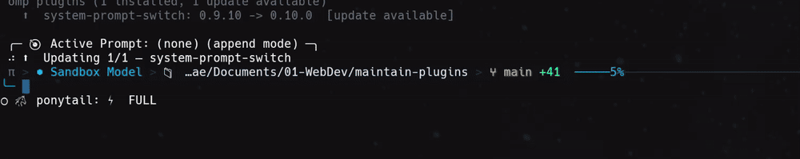

# maintain-plugins

> Know what's stale before the host does, then update every plugin in one confirmed step.

A Pi / OMP extension that compares the plugins your host has installed against the npm registry, tells you what moved, and updates the stale ones on request. Works in both Pi and OMP; it resolves the host it is running under and uses that host's own package manager.



---

## Install

### OMP
```bash
omp install npm:maintain-plugins
```

### PI
```bash
pi install npm:maintain-plugins
```

That's it. The extension registers on next session start. Works in both Pi and OMP.

---

## What it does

- **Session-start notice** — when at least one plugin has a newer version published, a row above the editor names each stale plugin with its current and newest version, then points at `/maint-updates-check` for the rest. It disappears the moment you use the session — run any command or send a message — and on its own after 20 seconds, so it can never outlive the moment it was meant for. The host's built-in commands like `/plugin` fire no event an extension can see, so that deadline is what guarantees it always leaves. The list is capped at four rows, with the remainder counted, so a machine with many stale plugins gets a summary rather than a wall of text.
- **Nothing can hide it** — the notice renders as a widget rather than a notification. The host *replaces* the status line when two plugins notify at once, so with a plain notification another plugin starting up could silently remove this one. A widget is a separate layer and is never overwritten.
- **Always-fresh report** — `/maint-updates-check` asks the registry every time, so a release published minutes ago shows up. It prints every installed plugin with its installed version, the newest published version, and whether an update is available, then points at `/maint-update-all` when anything is stale. Each registry request gives up after 5 seconds, so a network that drops packets cannot freeze the command. If the registry does not answer for every plugin it falls back to the last known versions and says so (`⚠️ Could not reach the registry for every plugin: showing cached versions from 12 min ago`). Stale rows carry a `⬆️` and current ones a `·`, because the host paints every notification level the same grey. It writes no plugin files.
- **Confirmed bulk update** — `/maint-update-all` lists every version delta *before* touching anything, asks for one confirmation, then rewrites the pin and lets the host's own installer do the work (`omp plugin install` under OMP, `npm install` under Pi).
- **Per-plugin progress** — while the batch installs, an animated row above the editor reads `⠹ ⬆️ Updating 2/5 — <name>` and disappears when the run ends. Installing produces no output of its own, so without it a long update is an unexplained pause.
- **Activating the update, per host** — after a successful update the session is still running the old plugin code. **Pi** asks whether to reload now, listing each plugin and the version it would activate; declining is fine, `/reload` is named for later. **OMP** cannot do this in a running session: its extension `reload()` only re-opens the session file, `/reload-plugins` does not re-run an installed extension (checked with a probe extension, whose factory ran once), and an extension cannot run `/reload-plugins` itself, because a message sent from an extension goes to the model. So under OMP the notice says to restart `omp`.
- **This plugin updates first** — when `maintain-plugins` itself is stale, `/maint-update-all` updates only it, because a newer release may carry the fix for upgrading everything else. The dialog lists the others as waiting. A one-shot marker is left behind (written when you accept the reload on Pi, straight after the update on OMP). The next session start — the reload on Pi, the restart on OMP — finds it and carries on with the remaining plugins under the new code: same confirmation, nothing is written without a yes, and the marker is ignored after 10 minutes. If you skip that and run `/maint-update-all` again, it warns that the installed version is ahead of the running one.
- **Manifest backup and automatic rollback** — the host's plugin `package.json` is copied before the pin is rewritten and restored if the install fails, so a pin for a version that never installed cannot be left behind.
- **Two kinds of failure, told apart** — an update can fail because the package would not install, or because it installed and the host then could not load it. The second is usually a plugin using a host API that only exists in the *other* host — pi's `registerEntryRenderer` does not exist in omp, for instance. The failure notice says which happened, and points at `/maint-uninstall-plugin` when removal is the fix.
- **Fresh on every session, cache only as a fallback** — every session start, `/maint-updates-check` and `/maint-update-all` ask the registry (one request per installed plugin) and rewrite the per-host cache. The cache is read only when the registry cannot be reached: the last known versions are then reported, and labelled as cached, rather than nothing, and a total outage does not reset the cache clock.
- **Disabled plugins are reported, never updated** — a plugin the host has switched off shows up as `(disabled)` and is skipped.
- **No downgrade** — a version is only treated as newer when it genuinely is; a registry that answers with an older number leaves the plugin alone.

---

## Commands

| Command | What it does |
|---|---|
| `/maint-updates-check` | Check installed plugin versions against npm (read-only) |
| `/maint-update-all` | Update every stale plugin, after showing the full delta and confirming |
| `/maint-uninstall-plugin` | Remove an installed plugin: pick from a list, then confirm |

## Demos

**`/maint-updates-check`** — a read-only report. Every plugin, its installed and newest version, and whether an update exists. Writes nothing:



**`/maint-update-all`** — the full update: confirmation, per-plugin progress, install, then the reload offer:



---

## What is read and written

| Host | Plugins read from | Updated by rewriting | Install command |
|---|---|---|---|
| **OMP** | `~/.omp/plugins/` (`package.json` + `omp-plugins.lock.json`) | `~/.omp/plugins/package.json` | `omp plugin install <pkg>@<ver>`, run from the plugin dir |
| **Pi** | `~/.pi/agent/npm/node_modules/<pkg>/package.json` (versions) and `~/.pi/agent/settings.json` (which packages are wanted) | `~/.pi/agent/npm/package.json` | `npm install --prefix <dir> <pkg>@<ver>` |

Check cache, per host: `~/.omp/agent/state/maintain-plugins/check.json` / `~/.pi/agent/state/maintain-plugins/check.json`.

Continue marker, same directory: `continue.json`. Written only when this plugin updated itself and others are waiting, consumed (and deleted) by the next session start **in the same working directory** (omp's `--continue` is per directory too, and a window on another project leaves it alone), ignored if older than 10 minutes.

Discovery reads the host's own manifests instead of shelling out to `omp plugin list` / `pi list`: those outputs differ per host, pi's has no JSON mode, and a CLI flag change would break discovery silently. A missing or unreadable manifest yields an empty list, never an error — this runs on session start, where a throw would take the session down.

A plugin that is listed but not actually installed is ignored. Removing one by hand leaves its lockfile entry behind, and reporting that leftover as upgradable would tell you to run `/maint-update-all` for a package that does not exist — `omp plugin uninstall` would refuse the same name. Both hosts are checked against `node_modules`, which is the same authority `omp plugin list` uses.

Each host is updated through **its own installer**, because that is what keeps the host's own record of what is installed current. `bun add` would rewrite only `package.json` and leave OMP's `omp-plugins.lock.json` on the old version, so the next check would offer the update you just applied all over again. `omp plugin install` rewrites the lock; `npm install` writes straight into `node_modules`, which is exactly what Pi reads.

---

## Safety notes

- **Nothing happens without a confirmation.** `/maint-updates-check` is read-only; `/maint-update-all` shows every delta and asks; `/maint-uninstall-plugin` lists what is installed, then asks a second time before deleting anything. Removal is the one irreversible action here and is **not** backed up by the manifest copy described above — reinstalling from npm is the way back.
- **A plugin pinned for a reason is your call.** The extension reports; it does not decide.
- **Self-update goes first, then restarts or reloads.** `maintain-plugins` is updated like any plugin, but alone and before the rest, and the others only update once the new code is in charge (a reload on Pi, a restart on OMP).
- **Test with a sandbox `HOME`, not `--profile`.** See [README.dev.md](./README.dev.md#testing-locally). Under `omp --profile <name>` the host reads `~/.omp/profiles/<name>/plugins` while this extension still targets `~/.omp/plugins`, so a test run in a profile would edit your real manifest.

---

## For developers

Architecture, layout, test suite, sandbox recipe, versioning and publish flow: see **[README.dev.md](./README.dev.md)**.

## License

MIT
